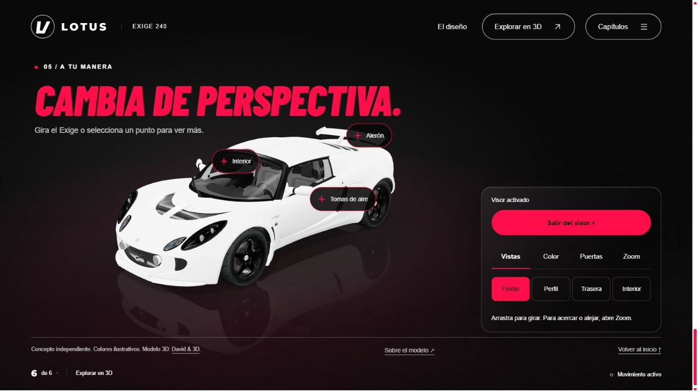

# Lotus Exige 240 · Puro instinto

Una web de storytelling con un Lotus Exige 240 en 3D. El recorrido presenta su silueta, tomas de aire, alerón e interior y termina en un estudio claro interactivo.



## Ejecutar en local

Con Node.js instalado, desde la carpeta del proyecto:

```sh
npm start
```

Abre **http://127.0.0.1:4173/**. No hace falta instalar dependencias ni generar un build: las librerías y los assets de la web están incluidos en `dist/`.

Para comprobar la sintaxis del JavaScript:

```sh
npm run check
```

## Qué incluye

- Pantalla de carga general hasta preparar el primer fotograma 3D; la entrada del coche comienza después de abrir la página.
- Entrada del coche desde el borde de la pantalla, con ruedas animadas y frenado gradual.
- Seis capítulos con fondos claros, columnas alternas y transiciones de cámara y texto ligadas al scroll.
- Visor con giro, vistas predefinidas, colores, apertura de puertas y zoom.
- Puntos interactivos para descubrir las tomas de aire, el alerón y el habitáculo.
- Estudio claro con títulos rojos, sombras suaves, reflejo tenue y controles alineados.
- Menú de capítulos compacto y puntos de detalle anclados al coche, con etiquetas que evitan el panel del visor.
- Diseño adaptable, navegación por teclado, movimiento reducido e imagen alternativa si falla el 3D.
- Assets, tipografías, Three.js y decodificador Draco alojados localmente.

## Estructura

```text
dist/
  index.html       Página y textos
  design.css       Estilos y diseño adaptable
  app.js           Escena 3D, animación y visor
  assets/          Modelo GLB, imagen alternativa y fuentes
  vendor/          Three.js, módulos y Draco
scripts/
  serve.mjs        Servidor local y rutas de revisión
docs/
  preview.png      Captura del visor interactivo
```

El proyecto usa HTML, CSS y JavaScript con módulos ES y un import map. No necesita React, Next.js ni un backend.

## Publicación

Publica el **contenido de `dist/`** en un servidor estático con HTTPS. Mantén la estructura de sus subcarpetas. Para ejecutarlo en local, usa el servidor indicado arriba en lugar de abrir `index.html` como archivo.

La configuración de la publicación en Sites se administra por separado y no se incluye en este repositorio.

### GitHub Pages

El flujo `.github/workflows/pages.yml` publica únicamente `dist/`, sin instalar dependencias ni ejecutar un build. Comprueba el JavaScript y los assets principales antes de desplegar.

Con Pages habilitado en el repositorio y GitHub Actions como origen, los cambios en `dist/` de la rama `main` se publican automáticamente. También puede ejecutarse manualmente desde **Actions → Publish GitHub Pages → Run workflow**.

La web está publicada en **https://josuelevi.github.io/lotus-exige-3d/**. El resultado de cada despliegue aparece en el entorno `github-pages`.

## Revisión local

El servidor incluye rutas que no se publican dentro de `dist/`:

- `/__qa/desktop?scene=explorar`: composición de escritorio.
- `/__qa/mobile?scene=explorar`: composición móvil.
- `/__qa/no-webgl`: alternativa cuando no está disponible WebGL.
- `/__qa/module-error`: recuperación si no carga el módulo de la experiencia.
- `/__qa/load-timeout`: recuperación con un límite de carga reducido para pruebas; combinar con `LOTUS_QA_DELAY_MS` al iniciar el servidor.
- `/__qa/lotus`: inspección del modelo.
- `/__qa/poster`: generación de la imagen alternativa.

## Créditos y licencias

- **Modelo 3D:** [AC - Lotus Exige 240 FREE](https://sketchfab.com/3d-models/ac-lotus-exige-240-free-a770a08d0c17446cbec7721f3dd1ede7), de [David & 3D](https://sketchfab.com/DavidAnd3D). Sus metadatos indican **Sketchfab Standard**. El modelo optimizado conserva la jerarquía y sus materiales. Los derechos del modelo pertenecen a su autor y su uso está sujeto a esa licencia.
- **Three.js:** licencia MIT en `dist/vendor/THREE-LICENSE.txt`.
- **Barlow Condensed y Montserrat:** licencias OFL en `dist/assets/fonts/`.
- **Draco:** conserva los avisos de licencia incluidos en los archivos del decodificador.

Este es un concepto independiente. El contenido describe rasgos visibles del modelo; no atribuye potencia, año ni equipamiento de una variante concreta. Los colores alternativos son de muestra.

El código del proyecto no tiene una licencia de distribución abierta asignada. Las licencias de terceros conservan sus propios términos.
